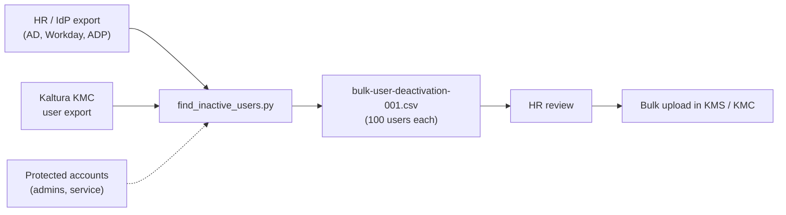

# 🧹 Kaltura User Cleanup (Manual Deprovisioning via CSV)

Kaltura's KMS and KMC systems do **not** currently support SCIM for automated user provisioning or deprovisioning.  
This guide outlines a workaround using exported CSV files to identify and bulk-remove inactive or exited users.

---




## 💡 Why This Matters

Every former employee left in a SaaS app is an orphaned account: a security risk, a finding in an access review, and often a paid seat. When an app has no SCIM, offboarding usually gets skipped. This process makes it repeatable.

---

## 📦 What's Included

- ✅ Step-by-step instructions to export and cross-reference user data
- 📄 CSV format for bulk deactivation
- 🛠 KMS/KMC upload guidance
- 📁 Suggested project file structure

---

## 🛠 Prerequisites

- Admin access to:
  - Active Directory (AD), Workday, or ADP
  - Kaltura MediaSpace (KMS)
  - Kaltura Management Console (KMC)
- CSV editor (Excel, Google Sheets, or similar)

---

## 🔄 Step-by-Step Deprovisioning Workflow

### 1. Export List of Active Users
Export a current list of active users from one of the following systems:
- Microsoft Active Directory
- Workday
- ADP

> This list will serve as your **source of truth** for active employees.

---

### 2. Export All Kaltura Users
Log in to **KMC**, go to **Users** and use the **Export** functionality to download a complete list of Kaltura users.

---

### 3. Compare and Filter
Using Excel or a script:
- Cross-reference the exported lists.
- Identify users who:
  - Are **not present** in the active employee list.
  - Are no longer with the company.
- Confirm these users are safe to delete (coordinate with HR or team leads as needed).

---

### 4. Create the Deletion CSV File

#### 📁 CSV Format:

| action | userID              |
|--------|---------------------|
| 3      | johndoe@null.com    |

- `action` column: enter `3` to mark user for deletion
- `userID` column: enter the user's Kaltura login (usually their email)
- Name your file something like:  
  `bulk-user-deactivation.csv`

> 🧠 **Best Practice:** Limit the list to **100 users per upload** for faster processing.

---

### 5. Upload the CSV to Kaltura

#### In the KMS Portal:
1. Navigate to **Manage Users**
2. Locate the **Bulk Upload** section
3. Upload your `bulk-user-deactivation.csv` file

#### In the KMC Portal:
1. Go to the **Upload Logs** section
2. Click **Bulk Upload** → check the **status** of your submission
3. Confirm processing and validate that users were removed

---

## ⚡ Automate Step 3 with the Script

`find_inactive_users.py` does the cross-reference for you. It needs no dependencies beyond Python 3.10+.

```bash
python find_inactive_users.py active_users.csv kaltura_users.csv \
    --active-col email --kaltura-col "User ID" \
    --exclude protected_accounts.txt
```

- Compares IDs case-insensitively
- Skips anything in `--exclude` (admins, service accounts, shared logins)
- Splits output into 100-user upload files: `bulk-user-deactivation-001.csv`, `-002.csv`, ...
- Prints a summary so you can sanity-check counts before uploading

> ⚠️ Always review the output with HR before uploading. Deletion in Kaltura is not reversible.

## 📂 Repo Structure

```
Kaltura-User-Cleanup/
├── README.md
├── find_inactive_users.py        # builds the deletion CSVs
└── sample-bulk-deactivation.csv  # example of the Kaltura bulk format
```
